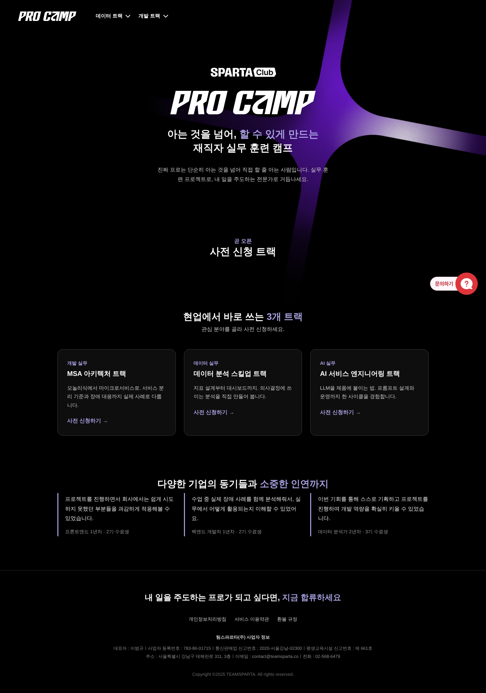
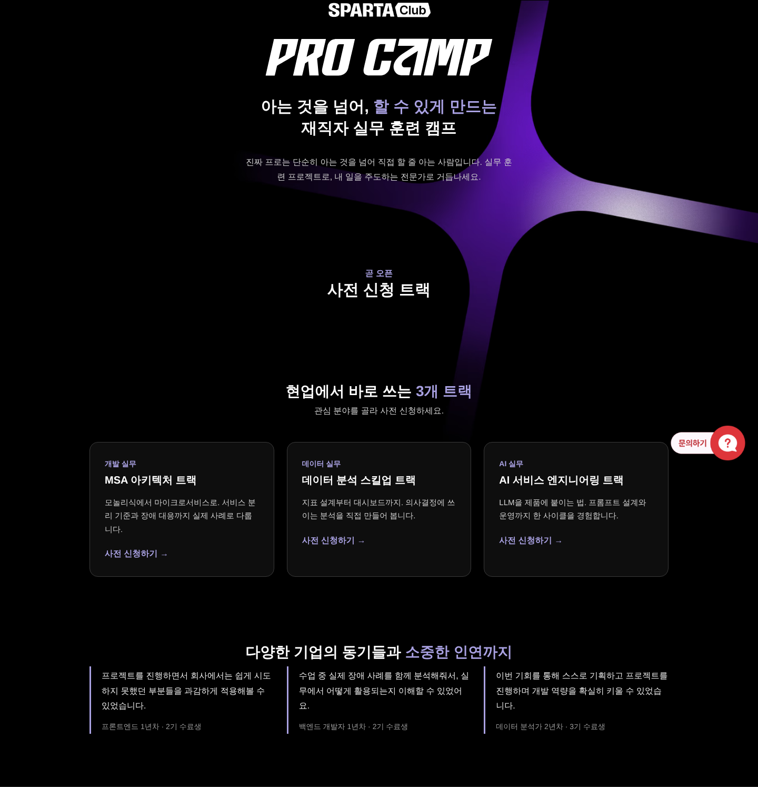
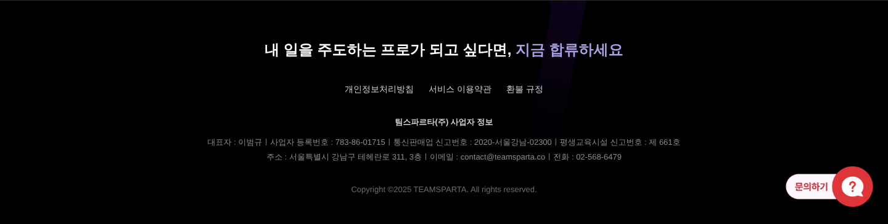

# 클론 코딩 — 재직자용 실무 실습 캠프 (PRO CAMP)

스파르타 **PRO CAMP** 랜딩 페이지를 HTML + CSS 로 클론한 과제입니다.

- **사용 기술**: HTML5 · CSS3 (프레임워크·JavaScript 미사용)
- **구성**: 헤더 / 메인(히어로 · 트랙 카드 · 수료생 후기) / 푸터
- **반응형**: 820px 기준 미디어쿼리 적용

## 실행 방법

```bash
# index.html 을 브라우저로 열면 됩니다
```

## 폴더 구조

```
CloneCoding/
├── index.html          # 전체 마크업
├── css/style.css       # 스타일
├── images/             # 로고·배경 등 에셋
└── docs/images/        # README 캡처
```

## 구현 화면

### 전체 화면



### 헤더

로고와 트랙 네비게이션. 820px 이하에서는 네비게이션이 숨겨집니다.


### 메인

히어로 영역, 트랙 카드 3개, 수료생 후기로 구성했습니다.



### 푸터

CTA 문구, 약관 링크, 사업자 정보, Copyright 를 담았습니다.



## 구현 포인트

| 항목 | 내용 |
| --- | --- |
| 레이아웃 | `display: flex` 로 헤더 정렬, 카드·후기 목록 3단 배치 |
| 반응형 | `@media (max-width: 820px)` — 트랙 네비 숨김, 카드 세로 배치, 상담 버튼 축소 |
| 색상 | 검정 배경 + 보라 포인트 `#A9A1E2` |
| 고정 요소 | `position: fixed` 로 우측 하단 상담 버튼 고정 |
| 시맨틱 태그 | `header` · `main` · `section` · `article` · `footer` 사용 |
