# 쇼핑몰 CRUD — Supabase + FastAPI

회원 · 상품 · 주문 3개 테이블을 Supabase(PostgreSQL)에 만들고,
FastAPI로 각 테이블의 CRUD API를 구현한 과제입니다.

- **스택**: Python 3.13 · uv · FastAPI · Supabase
- **API 문서**: 서버 실행 후 http://localhost:8000/docs

## 실행 방법

```bash
# 1) 의존성 설치
uv sync

# 2) 환경변수 설정 — .env.example 을 .env 로 복사하고 값을 채운다
#    Supabase 프로젝트 > Settings > API 에서 복사
cp .env.example .env

# 3) 테이블 생성 — Supabase SQL Editor 에 sql/schema.sql 내용을 붙여넣고 실행

# 4) 서버 실행
uv run uvicorn database_ai.main:app --reload
```

실행 후 http://localhost:8000/docs 에서 15개 API를 바로 눌러볼 수 있습니다.

## 테이블 구조

### 관계도

```
members (회원) ──1────< orders (주문) >────1── products (상품)
```

`orders` 가 `members` 와 `products` 를 각각 참조하는 구조입니다.
회원이 삭제되면 그 회원의 주문도 함께 삭제됩니다(`on delete cascade`).

### members (회원)

| 컬럼 | 타입 | 제약 | 설명 |
| --- | --- | --- | --- |
| `id` | bigserial | **PK** | 회원 번호 (자동 증가) |
| `email` | text | NOT NULL, UNIQUE | 이메일 (중복 불가) |
| `name` | text | NOT NULL | 이름 |
| `created_at` | timestamptz | NOT NULL, default now() | 가입 시각 |

### products (상품)

| 컬럼 | 타입 | 제약 | 설명 |
| --- | --- | --- | --- |
| `id` | bigserial | **PK** | 상품 번호 (자동 증가) |
| `name` | text | NOT NULL | 상품명 |
| `price` | integer | NOT NULL | 가격 |
| `stock` | integer | NOT NULL, default 0 | 재고 |
| `created_at` | timestamptz | NOT NULL, default now() | 등록 시각 |

### orders (주문)

| 컬럼 | 타입 | 제약 | 설명 |
| --- | --- | --- | --- |
| `id` | bigserial | **PK** | 주문 번호 (자동 증가) |
| `member_id` | bigint | **FK → members(id)**, NOT NULL | 주문한 회원 |
| `product_id` | bigint | **FK → products(id)**, NOT NULL | 주문한 상품 |
| `quantity` | integer | NOT NULL, default 1 | 수량 |
| `created_at` | timestamptz | NOT NULL, default now() | 주문 시각 |

### DDL

전체 DDL은 [`sql/schema.sql`](sql/schema.sql) 에 있습니다. PK·FK 정의는 다음과 같습니다.

```sql
create table members (
  id         bigserial    primary key,              -- PK
  email      text         not null unique,
  name       text         not null,
  created_at timestamptz  not null default now()
);

create table products (
  id         bigserial    primary key,              -- PK
  name       text         not null,
  price      integer      not null,
  stock      integer      not null default 0,
  created_at timestamptz  not null default now()
);

create table orders (
  id         bigserial    primary key,              -- PK
  member_id  bigint       not null references members(id) on delete cascade,  -- FK
  product_id bigint       not null references products(id),                   -- FK
  quantity   integer      not null default 1,
  created_at timestamptz  not null default now()
);
```

## Supabase 테이블 화면

| 항목 | 캡처 |
| --- | --- |
| 테이블 목록 | 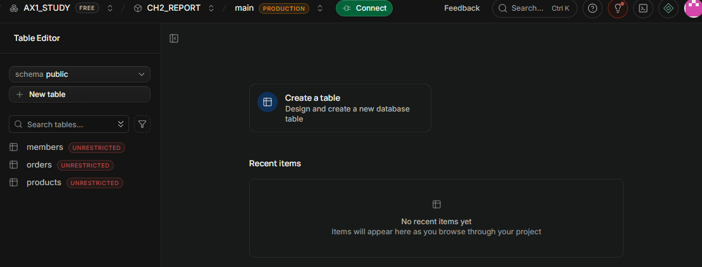 |
| members 구조 (PK) | 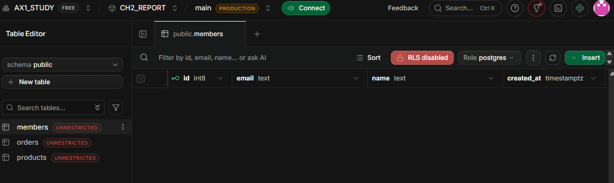 |
| products 구조 (PK) | 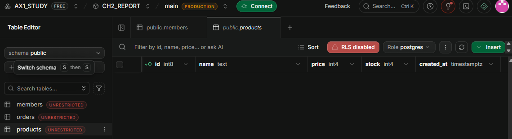 |
| orders 구조 (PK·FK) | 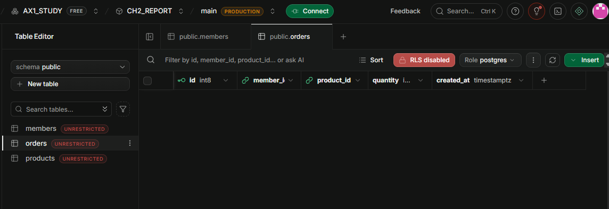 |

## 구현한 API

테이블당 5개씩, 총 15개입니다.

| 메서드 | 경로 | 설명 |
| --- | --- | --- |
| GET | `/members` | 회원 목록 조회 |
| GET | `/members/{member_id}` | 회원 단건 조회 |
| POST | `/members` | 회원 생성 |
| PATCH | `/members/{member_id}` | 회원 수정 |
| DELETE | `/members/{member_id}` | 회원 삭제 |
| GET | `/products` | 상품 목록 조회 |
| GET | `/products/{product_id}` | 상품 단건 조회 |
| POST | `/products` | 상품 생성 |
| PATCH | `/products/{product_id}` | 상품 수정 |
| DELETE | `/products/{product_id}` | 상품 삭제 |
| GET | `/orders` | 주문 목록 조회 |
| GET | `/orders/{order_id}` | 주문 단건 조회 |
| POST | `/orders` | 주문 생성 |
| PATCH | `/orders/{order_id}` | 주문 수정 |
| DELETE | `/orders/{order_id}` | 주문 삭제 |

### 구현 메모

- 조회 결과가 없으면 404, 수정할 값이 없으면 400을 돌려줍니다.
- `PATCH` 는 보낸 필드만 수정합니다(`exclude_none`). 안 보낸 필드를 `null` 로 덮어쓰지 않습니다.
- 주문 생성 시 없는 회원·상품을 참조하면 외래키 제약에 걸려 **400** 으로 거부됩니다.

### Swagger 전체 화면

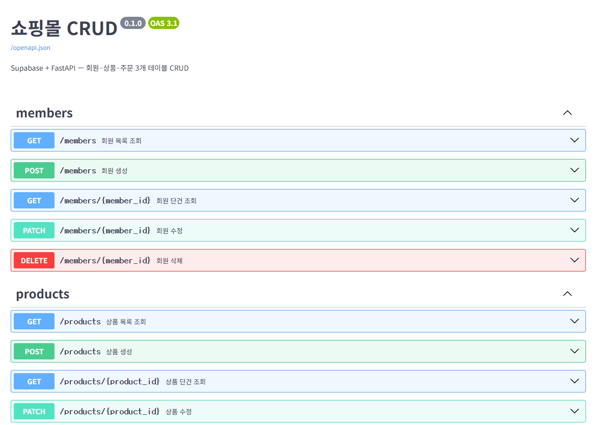

## CRUD 동작 화면

### Create — 회원 생성

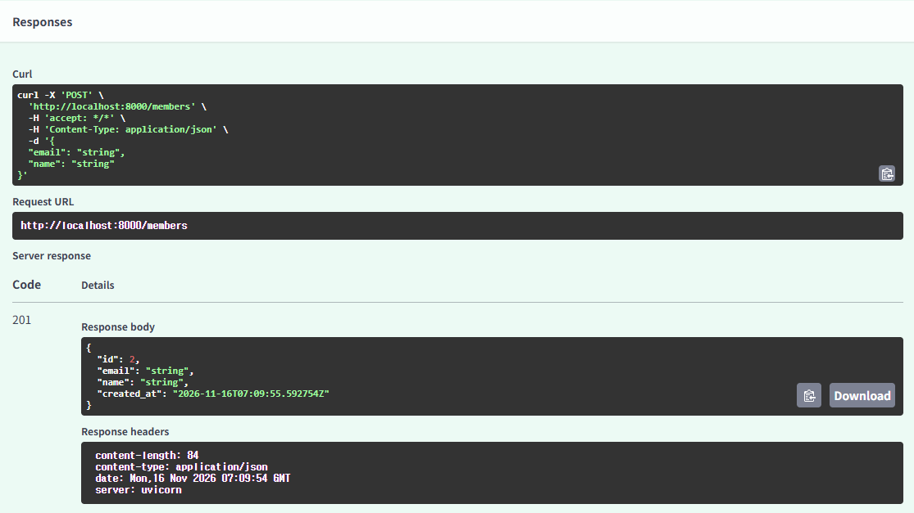

### Read — 회원 목록 조회

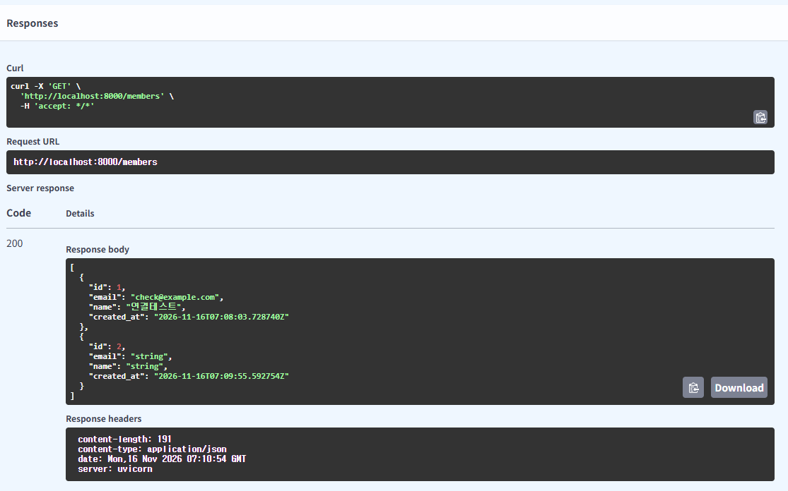

### Update — 회원 수정

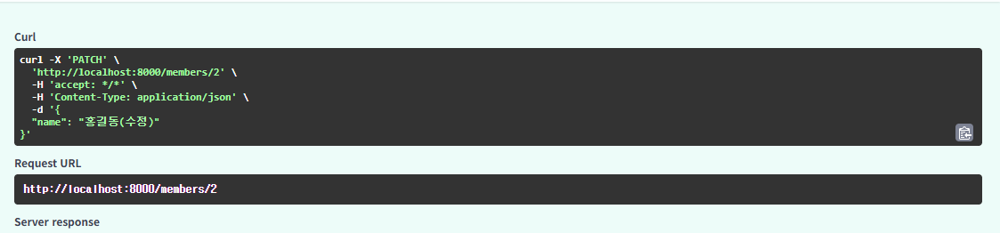

### Delete — 회원 삭제

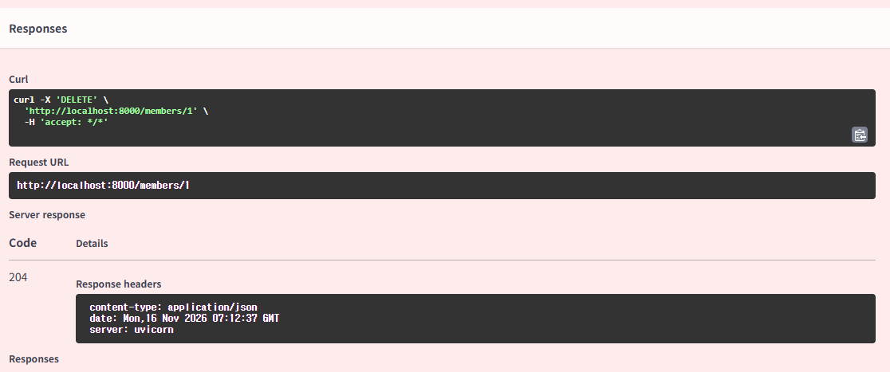

### 상품 · 주문

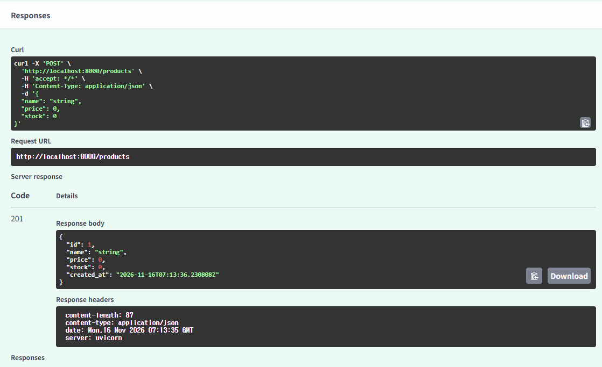

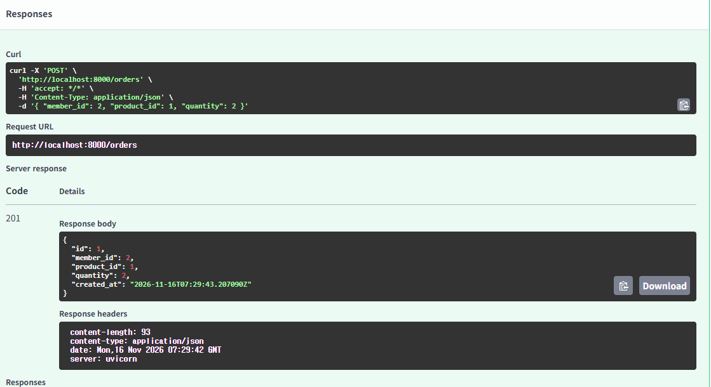

### 외래키(FK) 동작 확인

없는 `member_id` 로 주문을 생성하면 외래키 제약에 걸려 400 으로 거부됩니다.

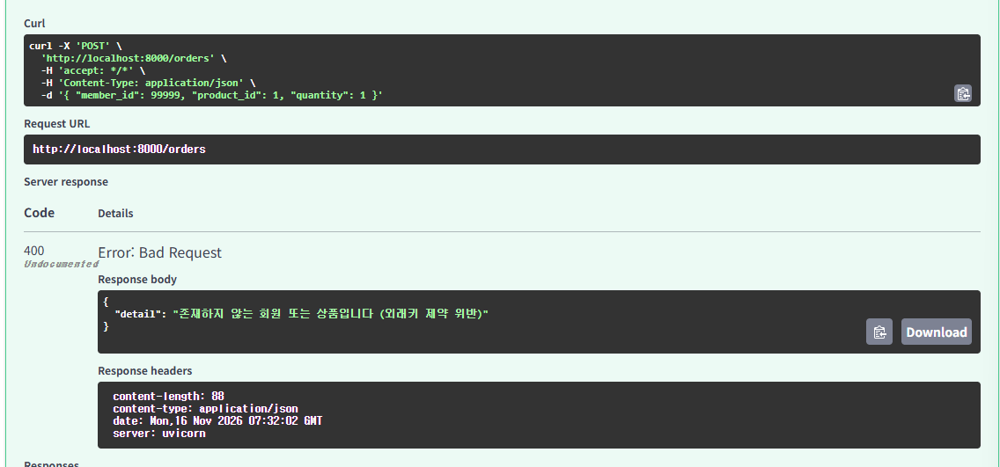

### Supabase에 저장된 데이터

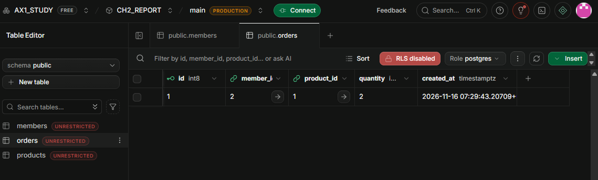

## 프로젝트 구조

```
DATABASE_AI/
├── sql/schema.sql              # 테이블 DDL
├── .env.example                # 필요한 환경변수 이름
└── src/database_ai/
    ├── config.py               # .env 읽기
    ├── db.py                   # Supabase 클라이언트
    ├── schemas.py              # 요청·응답 모델
    ├── main.py                 # 앱 조립
    └── routers/
        ├── members.py
        ├── products.py
        └── orders.py
```
