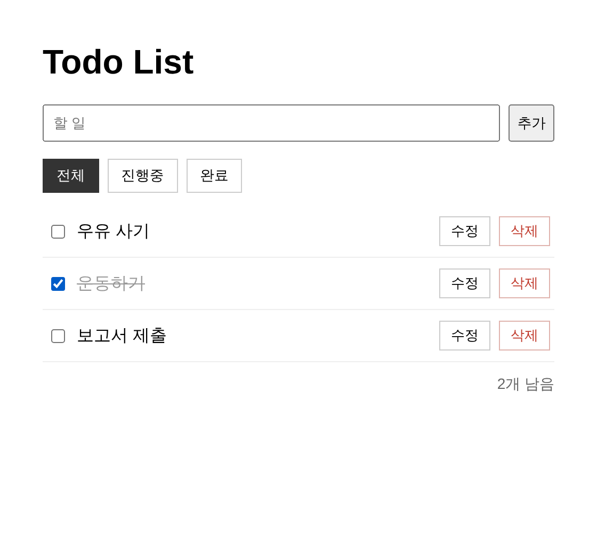

# Todo List (JavaScript 과제)

바닐라 JavaScript 로 만든 할 일 관리 페이지입니다.
추가 · 조회 · 수정 · 삭제가 모두 동작하며, 새로고침해도 목록이 유지됩니다.

## 실행 방법

```bash
# index.html 을 브라우저로 열면 됩니다
```

## 파일 구성

```
ToDoList/
├── index.html        # 화면 구조
├── css/style.css     # 스타일
└── js/todo.js        # 동작 (추가·조회·수정·삭제)
```

## 구현 기능

| 기능 | 동작 |
| --- | --- |
| **추가 (Create)** | 입력 후 `추가` 또는 Enter. 공백만 입력하면 추가되지 않습니다 |
| **조회 (Read)** | 전체 / 진행중 / 완료 필터. 목록이 비면 안내 문구가 뜹니다 |
| **수정 (Update)** | `수정` → 입력칸으로 바뀜 → `저장`(또는 Enter) / `취소`(또는 Esc) |
| **삭제 (Delete)** | `삭제` 버튼으로 항목 제거 |
| 완료 처리 | 체크박스로 토글, 완료 항목은 취소선 표시 |
| 남은 개수 | 완료하지 않은 항목 수를 하단에 표시 |
| 저장 | `localStorage` 에 저장되어 새로고침 후에도 유지 |

## 화면



## 시연 영상

> 추가 · 수정 · 삭제 · 조회가 동작하는 브라우저 화면 녹화 영상

<!-- 아래에 영상을 넣어주세요 -->

## 코드 설명

### 상태 관리

할 일은 `{ id, text, done }` 객체의 배열로 관리합니다.
`id` 는 `Date.now()` 로 만들어 항목을 구분하는 데 씁니다.

### 이벤트 위임

목록 항목은 화면을 그릴 때마다 새로 만들어지므로, 버튼마다 이벤트를 걸지 않고
`#todo-list` 한 곳에서 클릭을 받아 `data-action` 값으로 어떤 버튼인지 구분합니다.

```javascript
list.addEventListener("click", function (event) {
    const button = event.target.closest("button");
    if (!button) return;
    const action = button.dataset.action;   // edit | save | cancel | delete
    ...
});
```

### 다시 그리기

상태가 바뀌면 `render()` 하나만 호출합니다.
화면을 직접 고치지 않고 배열을 고친 뒤 전체를 다시 그리는 방식이라,
필터·카운터·안내 문구가 항상 같은 기준으로 맞춰집니다.
